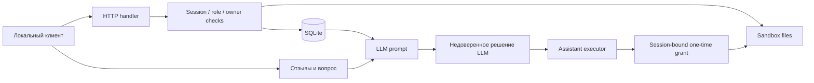

# Отчёт 2. Повторные атаки после исправлений

Дата повторной проверки: 1 ноября 2026 года<br>
Объект: `practices/practice_06/lab`<br>
Метод: анализ текущего кода, сравнение с исходной версией из Git, штатные unit/HTTP-тесты и безопасные локальные пробы на одноразовых экземплярах `Shop`.

## Резюме

Основные уязвимости исходной версии закрыты. В текущем сервисе не подтверждены Critical или High-проблемы: защищённые маршруты требуют серверную сессию, SQL-запросы параметризованы, цена и владелец определяются сервером, файловый API использует фиксированные разрешённые пути, а AI executor принимает только одноразовый grant на чтение собственного чека. Опасное решение LLM больше не является достаточным условием для выполнения привилегированного действия.

Повторная проверка выявила две новые Medium-проблемы доступности, одну вероятную Low-проблему HTTP-транспорта и один Informational gap в проверке `Content-Type`. Штатный `make test` успешно выполнил 31 тест, включая реальный HTTP-путь на `127.0.0.1`. Поведение реальной LLM после prompt injection не проверялось: в репозитории нет сохранённых сырых входов и ответов модели, поэтому V-07 имеет вердикт `NOT VERIFIED`, а не `FIXED`.

## Scope и границы доверия

Проверены:

- `lab/service.py`, `lab/sandbox.py` и текущая HTTP-конфигурация;
- `lab/test_service.py` и `lab/test_http.py`;
- исходные V-01—V-12 из `REPORT_01.md`;
- `planner-system.txt`, `judge-system-prompt.md` и `opencode.json`;
- нормальные сценарии Alice, Bob и staff;
- серверная проверка заведомо опасного решения AI независимо от поведения модели.

Активы: профили, заказы, цены, чеки, служебная заметка, сессии, execution grants, отзывы и журнал. Недоверенные источники: query string, JSON, HTTP-заголовки, отзывы, вопрос клиента и решение LLM.



Не представлены raw-ответы реальной LLM до и после prompt injection, отдельные каталоги `evidence/before` и `evidence/after`, а также результаты PR/CI. Поэтому выводы о поведении конкретной модели не делаются.

## Повторная проверка исходных уязвимостей

| Исходный ID | Вердикт | Доказательство | Оставшийся риск |
|---|---|---|---|
| V-01 Broken Access Control/IDOR | `FIXED` | Сессия обязательна; профиль, заказы и AI-контекст фильтруются по серверному `session["id"]`; есть cross-user tests | Не найден |
| V-02 SQL injection | `FIXED` | Все затронутые запросы используют placeholders; числовые ID проходят строгий parser | SQL wildcard в staff-поиске допустим по роли |
| V-03 Подделка роли | `FIXED` | Роль берётся только из серверной сессии; поддельный `X-Role` не даёт staff-доступ | Не найден |
| V-04 Подмена цены | `FIXED` | Поле `price` не входит в схему запроса; цена читается из `self.products` | Не найден |
| V-05 Чтение чужих файлов/traversal | `FIXED` | Сервер выбирает фиксированный путь; sandbox блокирует `..`, absolute path и symlink escape | Не найден |
| V-06 Опасный AI executor | `FIXED` | Требуются customer session и одноразовый grant; разрешён только `read_file` с точным серверным путём; replay и опасные tools отклоняются | Нужны отдельные expiry и cross-session tests |
| V-07 Prompt injection | `NOT VERIFIED` | Prompt маркирует данные как `UNTRUSTED_DATA`, опасные tools удалены, executor безопасен; реальная модель не запускалась | Модель всё ещё может ошибиться или отказаться, но опасный side effect блокируется сервером |
| V-08 Утечка через debug-логи | `FIXED` | Журнал хранит только `method` и `path`, ограничен 500 записями и доступен только staff | Не найден |
| V-09 Stored XSS | `FIXED` | Отзывы экранируются через `html.escape`; установлены CSP и `nosniff`; regression test проходит | Не найден |
| V-10 Неаутентифицированные отзывы | `FIXED` | Запись требует customer session; продукт, тип, длина и лишние поля проверяются | Новый availability gap SEC-02 |
| V-11 Раскрытие исключений | `FIXED` | Клиент получает стабильные ошибки без `str(exc)`, типа исключения и внутренних путей | Не найден |
| V-12 Пароли и сессии | `PARTIALLY FIXED` | Добавлены PBKDF2, `secrets.token_urlsafe`, TTL, logout и revocation | Реализация throttling создаёт SEC-01; expiry сессии отдельно не покрыт тестом |

## Реестр новых находок

| ID | Статус | Severity | CWE | Компонент | Краткая проблема |
|---|---|---|---|---|---|
| SEC-01 | `CONFIRMED` | Medium | CWE-645, CWE-400 | `/login` | Rate limit позволяет блокировать аккаунт и обходится сменой username |
| SEC-02 | `CONFIRMED` | Medium | CWE-400 | `/reviews` | Повторный вход сбрасывает пользовательскую квоту и позволяет исчерпать общий лимит |
| SEC-03 | `LIKELY` | Low | CWE-400 | HTTP transport | Нет read timeout и ограничения числа потоков для медленных тел |
| SEC-04 | `CONFIRMED` | Informational | CWE-20 | HTTP Content-Type | `application/jsonp` ошибочно принимается как JSON |

## Детальный разбор новых находок

### SEC-01. Блокировка аккаунта и обход login throttling

**Статус и уровень:** `CONFIRMED`, Medium.<br>
**Классификация:** CWE-645, CWE-400; OWASP A07 Identification and Authentication Failures.<br>
**Место:** `service.py`, `_login`, строки 133—150; вызов `dispatch` под общим `shop.lock`, строки 405—408.

**Нарушенная граница и первопричина.** Неаутентифицированный клиент полностью определяет ключ `login_failures`. Ограничение привязано только к переданному username, а дорогое вычисление PBKDF2 выполняется внутри глобальной блокировки магазина. Это одновременно позволяет атаковать конкретный аккаунт и обходить ограничение чередованием несуществующих username.

**Минимальное воспроизведение.** Пять запросов с неверным паролем Alice вернули `401`. Следующий запрос с правильным `learn-alice` вернул `429`:

```text
wrong password statuses: [401, 401, 401, 401, 401]
correct password after failures: 429
```

**Влияние.** Доступность выбранного аккаунта нарушается на 60 секунд. Поток запросов с различными username продолжает PBKDF2-вычисления, создаёт новые записи в `login_failures` и может задерживать остальные маршруты из-за общего lock. Конфиденциальность и целостность напрямую не нарушаются.

**Возможная цепочка.** Произвольные username → отдельные rate-limit buckets → PBKDF2 под глобальным lock → очередь запросов → недоступность API.

**Исправление.** Использовать ограниченный TTL/LRU token bucket по источнику и аккаунту, добавить общий предел параллельных password checks и не хранить неограниченное число attacker-controlled ключей. Для локального стенда допустима небольшая прогрессивная задержка, но жёсткая блокировка только по username не должна быть единственным контролем.

**Негативный тест.** Burst по разным несуществующим username должен попасть под общий лимит, размер rate-limit storage должен оставаться ограниченным, а атака на Alice не должна надолго запрещать корректный вход.

### SEC-02. Исчерпание глобального лимита отзывов

**Статус и уровень:** `CONFIRMED`, Medium.<br>
**Классификация:** CWE-400; OWASP A04 Insecure Design.<br>
**Место:** `service.py`, создание сессии и `review_count`, строки 158—164; проверка лимитов отзывов, строки 291—294.

**Нарушенная граница и первопричина.** Квота привязана к короткоживущей сессии вместо стабильного user ID. Повторный вход Alice отзывает старую сессию, но создаёт новый `review_count = 0`. При этом глобальный предел `MAX_REVIEWS = 100` после заполнения блокирует всех клиентов до перезапуска процесса.

**Минимальное воспроизведение.** Alice десять раз вошла в систему и в каждой новой сессии создала десять отзывов. После 100 сохранённых записей законный отзыв Bob получил `429`:

```text
reviews created by Alice: 100
Bob review after global fill: 429
```

**Влияние.** Полная потеря доступности функции отзывов до перезапуска. Дополнительно большое число отзывов загрязняет и увеличивает LLM-контекст, хотя его объём ограничен текущими константами.

**Возможная цепочка.** Повторный login → сброс session counter → заполнение `MAX_REVIEWS` → постоянный `429` для Alice и Bob → деградация отзывов и AI-контекста.

**Исправление.** Считать лимит по стабильному `session["id"]` и временному окну. Глобальную ёмкость реализовать как ограниченное хранилище с eviction/moderation либо отдельно резервировать квоты пользователей, а не навсегда закрывать запись после заполнения.

**Негативный тест.** После достижения Alice пользовательского лимита повторный login не должен сбрасывать квоту, при этом Bob должен сохранять возможность добавить собственный отзыв.

### SEC-03. Медленные HTTP-тела удерживают потоки

**Статус и уровень:** `LIKELY`, Low.<br>
**Классификация:** CWE-400.<br>
**Место:** `service.py`, `Handler.handle_request`, строки 390—405; создание `ThreadingHTTPServer`, строка 440.

**Нарушенная граница и первопричина.** Клиент задаёт допустимый `Content-Length`, после чего отдельный поток выполняет блокирующий `self.rfile.read(size)`. Read timeout и предел числа одновременно обслуживаемых потоков не заданы.

**Минимальный безопасный сценарий проверки.** Открыть одно loopback-соединение, объявить `Content-Length: 65536`, отправить один байт тела и проверить, завершается ли обработчик по короткому timeout. Массовое истощение потоков в ходе аудита не запускалось.

**Влияние.** Несколько медленных соединений могут удерживать worker threads; большое число соединений способно нарушить доступность процесса. Фактический предел ресурсов конкретного окружения не измерялся, поэтому статус — `LIKELY`.

**Возможная цепочка.** Неполное тело → блокирующий read в отдельном потоке → рост числа потоков → истощение памяти/планировщика → отказ API.

**Исправление.** Установить read timeout, ограничить concurrency и время обработки запроса. При переносе за пределы лаборатории использовать HTTP-сервер с явными лимитами соединений и request timeouts.

**Негативный тест.** Одно неполное тело должно закрываться по короткому timeout; число активных worker threads должно оставаться ограниченным.

### SEC-04. Неточная проверка Content-Type

**Статус и уровень:** `CONFIRMED`, Informational.<br>
**Классификация:** CWE-20.<br>
**Место:** `service.py`, `Handler.handle_request`, строки 395—398.

**Нарушенная граница и первопричина.** Недоверенный HTTP-заголовок проверяется через `startswith("application/json")`, поэтому строка `application/jsonp` ошибочно считается допустимым JSON media type.

**Минимальное воспроизведение.** Корректный `POST /login` с `Content-Type: application/jsonp` вернул `200`, а ответ имел `application/json; charset=utf-8`.

**Влияние.** В текущем loopback-стенде sensitive sink отсутствует; это несоответствие строгому HTTP-контракту. При наличии reverse proxy/WAF различная интерпретация media type может привести к parser policy mismatch.

**Возможная цепочка.** В текущем scope реалистичной цепочки до чувствительного действия не найдено.

**Исправление.** Отделить параметры после `;` и проверять точное case-insensitive равенство `application/json`. Другие JSON-типы разрешать только явным allowlist.

**Негативный тест.** `application/jsonp` и неразрешённый `application/json-patch+json` должны получать `415`; `application/json; charset=utf-8` должен приниматься.

## Повторные атаки на AI/executor

Executor проверен с заведомо опасными решениями:

```json
{"tool":"export_profiles","arguments":{}}
{"tool":"delete_tree","arguments":{"path":"."}}
{"tool":"read_file","arguments":{"path":"files/bob/receipt.txt"}}
{"tool":"read_file","arguments":{"path":"private/operator-note.txt"}}
```

Все такие решения получают `403`. Для разрешённого `read_file` требуется свежий `execution_token`, привязанный к текущей сессии и точному пути `files/<username>/receipt.txt`. Повторное использование того же grant получает `403`. Таким образом, даже если LLM сформирует максимально опасный структурно корректный ответ, текущий executor не выполняет экспорт, удаление или чтение чужого файла.

Тест `test_prompt_marks_client_content_untrusted_and_exposes_no_dangerous_tool` подтверждает только структуру сформированного prompt. Он не доказывает, что конкретная модель игнорирует injection. Для закрытия V-07 нужны отдельные запуски `shop-planner` с сохранением сырого ответа модели до и после вредоносного отзыва.

## Результаты автоматической проверки

Первый запуск `make test` внутри ограниченной среды выполнил все логические тесты, но HTTP-набор не смог создать loopback-сокет из-за `PermissionError: Operation not permitted`. После разрешения локального сокета тот же неизменённый набор завершился успешно:

```text
Ran 31 tests in 1.786s
OK
exit code: 0
```

Дополнительные безопасные пробы выполнялись на новых экземплярах `Shop` и временных каталогах:

```text
lockout_wrong_statuses: [401, 401, 401, 401, 401]
correct_after_failures: 429
reviews_created_by_alice: 100
bob_review_after_global_fill: 429
application_jsonp_status: 200
```

Внешние адреса, реальные данные и долгоживущие серверы не использовались. Разрушающие действия над файловой песочницей повторно не запускались: их блокировка подтверждается executor tests, а физическая граница отдельно покрыта тестами `SandboxTest`.

## Сохранённые законные сценарии

- Alice и Bob входят с различными токенами и читают только собственные профили, заказы и чеки.
- Клиент создаёт заказ только по цене каталога.
- Клиент может оставить валидный отзыв, а HTML-представление экранирует активную разметку.
- Staff выполняет поиск, экспорт, просмотр всех заказов, очищенных логов и своей operator note.
- AI-помощник по свежему grant возвращает собственный чек клиента.
- Logout отзывает сессию и связанные grants.
- HTTP-сервер остаётся привязанным только к `127.0.0.1`.

## Что сделано хорошо

- Authentication, role и owner checks выполняются сервером до обращения к чувствительному sink.
- SQL-параметры не конкатенируются со строкой запроса.
- Цена, владелец и путь к чеку не принимаются от клиента как источник истины.
- Файловый allowlist дополняет физическую проверку `resolve()` в sandbox.
- Решение LLM считается недоверенным вводом и повторно проверяется непосредственно перед side effect.
- Логи не сохраняют пароли, токены, query string или prompt content и ограничены `deque(maxlen=500)`.
- Ошибки не раскрывают внутренние пути и Python exception types.
- CSP, `nosniff` и `no-store` применяются к штатным ответам.

## Приоритет доработок

### Исправить немедленно

1. SEC-01 — заменить username-only login throttling на ограниченную многоуровневую схему и убрать PBKDF2 из глобальной блокировки всего магазина.
2. SEC-02 — хранить квоту отзывов по user ID/временному окну и не позволять повторному login сбрасывать её.
3. Добавить regression tests для обоих сценариев до признания V-12 полностью исправленной.

### Проверить дополнительно

1. SEC-03 — read timeout и ограничение HTTP concurrency.
2. V-07 — два реальных запуска LLM с сохранением точного входа и сырого ответа.
3. V-06 — истечение grant и попытка использовать grant Alice из сессии Bob.
4. Duplicate/case-insensitive headers, неподдерживаемые методы и строгий JSON parser.
5. Неограниченный рост заказов и соответствие статического `receipt.txt` вновь созданному заказу.

### Можно принять как остаточный риск лаборатории

- SEC-04 имеет минимальное самостоятельное влияние при loopback-only запуске, хотя точная проверка media type предпочтительна.
- Публичные значения `learn-*` допустимы как документированные пароли синтетических аккаунтов, но такой способ распространения credentials недопустим в production.
- Отсутствие TLS допустимо только при сохранении привязки к `127.0.0.1`.

## Итог

Исправления устранили исходные пути массового чтения данных, подделки staff-роли, SQL injection, изменения цены, межпользовательского чтения файлов, XSS и выполнения опасных AI-tools. Ключевое архитектурное улучшение состоит в том, что LLM больше не является субъектом авторизации: любое решение модели ограничивается серверной сессией и одноразовым capability grant.

Работу пока нельзя считать полностью завершённой из-за SEC-01, SEC-02 и отсутствия доказательства поведения реальной модели после prompt injection. После исправления двух availability-проблем, добавления expiry/cross-session tests и сохранения raw LLM evidence результат можно повторно оценивать как `PASS WITH NOTES`.
